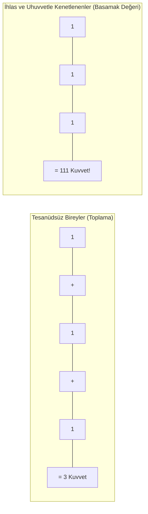

# 🤝 Ders 02: Uhuvvet, Tesanüd ve Şahs-ı Manevi Mimarisi

> *"Mü'min kardeşini sever ve sevmeli. Fakat fenalığı için yalnız acır. Tahakkümle değil, belki lütufla ıslahına çalışır."*  
> **— 22. Mektup (Uhuvvet Risalesi)**

---

## 1. Problem Tanımı: Dağınık Düğümlerin Çöküşü

Dağıtık bir bilgisayar ağında (distributed network) düğümler (node'lar) birbirleriyle iletişim kurmak yerine birbirlerinin paketlerini engellemeye başlarsa sistem kendi kendini kilitler. Bugün İslam dünyasının ve hakikat yolcularının en büyük zaafı dış saldırılardan ziyade **içerideki tesanüdsüzlük (dayanışma eksikliği), alınganlık, tarafgirlik ve adavettir (düşmanlıktır).**

**22. Mektup (Uhuvvet Risalesi)**, mü'minler arasındaki kırgınlık, küslük ve husumetin hem hakikatte, hem hikmette, hem insaniyette, hem de İslamiyette ne kadar büyük bir zulüm ve mantıksızlık olduğunu altı vecihle ispat eder.

---

## 2. Mü'mine Düşmanlık Etmenin Mantıksızlığı (Çakıl Taşı ve Kâbe Temsili)

Bir mü'minin kalbinde ve kimliğinde onu sevmeyi gerektiren sayısız yüce bağ vardır:
* İmanları birdir, Yaratıcıları birdir, Peygamberleri birdir, Kıbleleri birdir, Kur'anları birdir, ahiret yolculukları birdir.
* Bu bağların her biri **Uhud Dağı** büyüklüğünde birer muhabbet ve kardeşlik sebebidir.
* Öte yandan bir mü'minde bulunan şahsi kusurlar, huysuzluklar veya hatalar ise **küçük çakıl taşları** hükmündedir.

> **Soru:** Çakıl taşlarını Uhud Dağı'ndan daha ağır tutup, Kâbe hürmetindeki iman bağını bir kenara atarak mü'min kardeşine kin beslemek ne kadar akıl kârıdır? Kalp mi bozulmuş, terazi mi şaşmış?

---

## 3. Hatalara Şefkat Gözüyle Bakmak (Sıfatları Şahıstan Ayırmak)

Bir insanın üzerinde hem elmaslar (iman, vicdan, güzel hasletler) hem de çamurlu lekeler (kötü huylar, nefsani kusurlar) bulunabilir.
1. **Kötü sıfat, şahsın tamamı değildir:** Bir kardeşin sana haksızlık ettiğinde onun *o davranışına* rıza göstermezsin; ama imanlı zatına düşman olamazsın.
2. **Hasta adama öfkelenilmez, acınır:** Kötü ahlak manevi bir hastalıktır. Gözü ağrıyan veya nöbet geçiren bir hastaya tokat atılmaz; şefkatle tedavisine ve duasına koşulur.
3. **Kusuru nefsine ve şeytana ver:** Bir mü'minden sana bir eziyet geldiğinde *"Onun nefsi ve şeytanı onu kandırdı, asıl fıtratı imanlıdır"* diyerek öfkeni şahsa değil, aradaki fitne ateşine yönelt.

---

## 4. Şahs-ı Manevî ve "1 + 1 + 1 = 111" Sırrı

Modern çağ, bireysel kahramanların değil, organize sistemlerin ve kolektif yapıların (**Şahs-ı Manevî**) çağıdır. Küfür ve sefahet; medya, algoritmalar, küresel kültür endüstrisi ve felsefi akımlarla organize bir **şahs-ı manevî** halinde hücum etmektedir.

Buna karşı tek başına direnmeye çalışmak, bir fırtınaya karşı elinde kibrit çöpüyle çıkmaya benzer. Risale-i Nur'un sunduğu çözüm **tesanüd (omuz omuza kenetlenme)** sırrıdır:

* Üç tane **`1`** ayrı ayrı durduğunda toplam kıymetleri sadece **`3`** eder.
* Ama aynı çizgide, omuz omuza, ihlas ve uhuvvet sırrıyla yan yana geldiklerinde **`111`** kıymet ve kuvvetini kazanırlar! Dört kişi kenetlense **`1.111`** olur!

---

## 5. Uhuvvetin Pratik Protokolü

1. **Üç Günden Fazla Küslüğü Sonlandır:** Peygamberî ölçü gereği bir mü'mine üç günden fazla dargın durmak iman kardeşliğiyle bağdaşmaz. İlk selamı veren, nefsini yenen kahramandır.
2. **Gıybet Güvenlik Duvarı (`Firewall`):**22. Mektup'un zeylinde gıybet; aklın, kalbin, insaniyetin, vicdanın, fıtratın ve milliyetin nefret ettiği **altı katlı bir manevi cinayet** olarak tanımlanır. Meclisinde gıybet açıldığında konuyu nazikçe değiştir veya mü'min kardeşinin hukukunu koru.
3. **Müsbet Hareket:** Bizim mesleğimiz yıkmak, kavga etmek ve ötekileştirmek değil; tamir etmek, imar etmek ve sevdirmektir.

---

## 📝 Ders Özeti ve Eylem Adımları

* Kalbinde kırgınlık veya soğukluk taşıdığın bir mü'min kardeşini düşün. Onun hatalarını değil, kalbindeki iman cevherini hatırla ve bugün onun hayrı için ismen dua et.
* **Kaynak Okuma:** *Mektubat*, **22. Mektup** (Birinci ve İkinci Mebhas ile Gıybet Bahsi).

---

⬅️ **[Önceki Ders: İhlas Risalesi Düsturları](./01-ihlas-risalesi-dusturlari.md)** | ➡️ **[Sonraki Modül: 01 - İman ve Küfür Muvazeneleri](../01-Iman-ve-Kufur-Muvazeneleri/README.md)**
