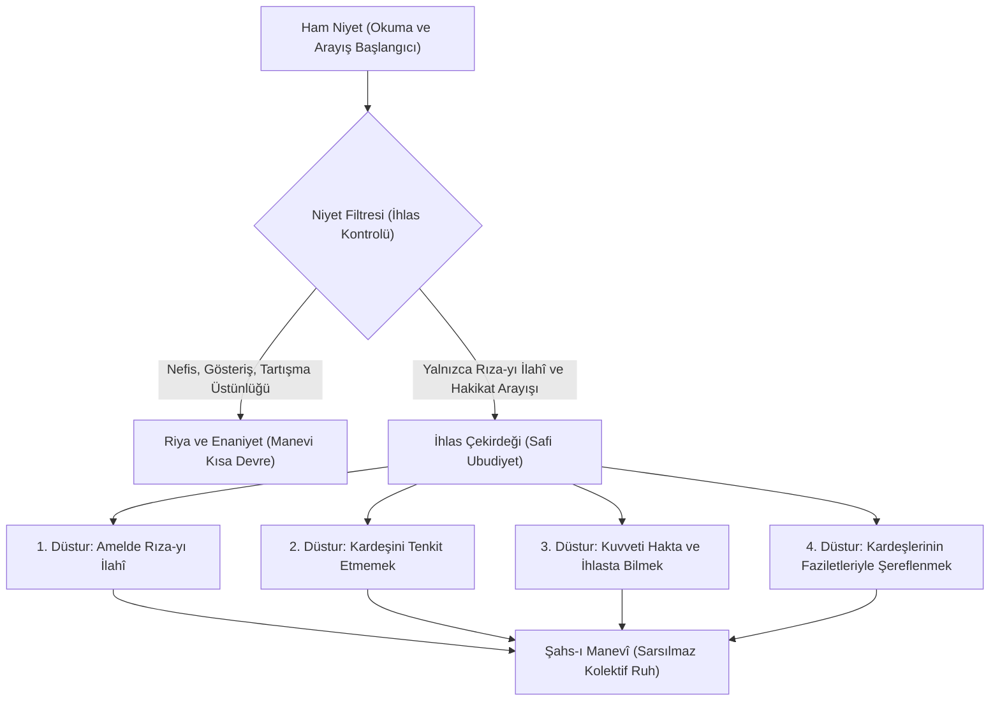

# 🧭 Modül 00: Init — Niyet, İhlas ve Uhuvvet Mimarisi

> *"Ey ahiret kardeşlerim ve ey hizmet-i Kur'aniyede arkadaşlarım! Bilirsiniz ve biliniz: Bu dünyada, hususan uhrevî hizmetlerde en mühim bir esas, en büyük bir kuvvet, en makbul bir şefaatçi, en metin bir nokta-i istinad, en kısa bir tarîk-ı hakikat, en makbul bir dua-i manevî, en kerametli bir vesile-i makasıd, en yüksek bir haslet, en safi bir ubudiyet: **İhlastır.**"*  
> **— 21. Lem'a (İhlas Risalesi)**

---

## 🎯 Modülün Amacı (Sistem Başlatma / `init()`)

Bir işletim sistemi başlatılırken (`boot / init` aşamasında) bellek bozuksa veya çekirdeğe zararlı bir yazılım (rootkit) sızmışsa, üzerine kuracağınız en gelişmiş uygulamalar dahi hatalı sonuç üretir. Manevi ve zihinsel inşada da ilk adım **ilmî malumat biriktirmek değil, niyeti tashih etmek (düzeltmek) ve ihlası kuşanmaktır.**

Bu modül, hakikat yolculuğuna çıkmadan önce kalbe ve zihne kurulması gereken **temel güvenlik katmanıdır (Manevi Antivirüs):**
1. Neden okuyoruz, neden öğreniyoruz, neden anlatıyoruz? Sadece **Rıza-yı İlahî** için mi, yoksa takdir edilmek, tartışma kazanmak veya entelektüel tatmin için mi?
2. Hakikat yolcuları arasındaki kardeşlik (uhuvvet) ve dayanışma (tesanüd) bağını enaniyet virüslerinden nasıl koruruz?

---

## 🧠 Bilişsel ve Manevi Mimari

### Temel Hakikat Çerçevesi

| Boyut | Gaflet / Nefis Yaklaşımı (Bozuk Konfigürasyon) | Nuranî / İhlas Yaklaşımı (Temiz Konfigürasyon) |
| :--- | :--- | :--- |
| **Gaye** | İnsanların teveccühü, beğeni, makam, "ne güzel biliyor" denmesi | *"Amelinizde rıza-yı İlahî olmalı."* Allah razı olsa, bütün dünya küsse ehemmiyeti yok. |
| **Ölçü** | Sayısal çokluk, popülerlik, dünyevi başarı | Keyfiyet (nitelik), samimiyet, bir tek kalbin dahi imanının kurtulması |
| **Kardeşlik** | Rekabet, kıskançlık, kendi mesleğini tek doğru sanıp başkasını çürütmek | *"Mesleğim haktır veya daha güzeldir"* diyebilmek; *"Yalnız benim mesleğim haktır"* dememek |
| **Vazife Sınırı** | Sonucu yaratmaya kalkışmak (insanları zorla hidayete getirmeye çalışıp ümitsizliğe düşmek) | Vazifesini (okuma, yaşama, tebliğ) yapıp, **Vazife-i İlahiyeye** (hidayeti yaratmaya) karışmamak |

---

## 📚 Bu Modüldeki Dersler

1. **[Ders 01: İhlas Risalesi Düsturları ve Manevi Antivirüs](./01-ihlas-risalesi-dusturlari.md)**  
   *20. ve 21. Lem'alar ışığında ihlasın dört temel düsturu, ihlası kıran üç gizli engel ve ihlası koruyan iki kesin ilaç (Rabıta-i Mevt ve Tefekkür-ü İmanî).*
2. **[Ders 02: Uhuvvet, Tesanüd ve Şahs-ı Manevi Mimarisi](./02-uhuvvet-ve-tesanud.md)**  
   *22. Mektup (Uhuvvet Risalesi) ışığında mü'minler arası adavet ve kırgınlığın mantıksızlığı, kardeşlik hukuku ve kolektif ruhun inşası.*

---

## 🔬 Nefis Muhasebesi (Self-Check)

Bu modüldeki derslere geçmeden önce kendine dürüstçe şu üç soruyu sor:
1. Hiç kimse bilmese, kimse beni takdir etmese ve dünyevi hiçbir karşılık almasam da bu hakikatleri aynı şevkle okumaya ve yaşamaya devam eder miyim?
2. Bir hakikati dinlerken veya okurken ilk refleksim *"Bunu kendimde nasıl düzeltirim?"* mi oluyor, yoksa *"Bunu filanca kişiye nasıl laf sokmak için kullanırım?"* mı?
3. Kendi eksiklerime karşı avukat, başkalarının hatalarına karşı savcı gibi mi davranıyorum?

---

## 🛠️ Günlük Pratik Uygulama

* **Okuma Öncesi Niyet Protokolü:** Her ders veya Risale okumasına başlamadan önce 10 saniye dur, derin bir nefes al ve kalbinden şunu geçir: *"Ya Rabbi! Şu okumamı nefsimin ıslahına, imanımın tahkikine ve yalnız Senin rızana vesile kıl. Beni riyadan ve kibirden muhafaza eyle."*
* **Temel Kaynak Okuması:** *Lem'alar* külliyatından **20. Lem'a** ve **21. Lem'a**'yı, *Mektubat*'tan **22. Mektup (Birinci Mebhas)** bölümünü sindirerek oku.

---

⬅️ **[Ana Sayfaya Dön](../README.md)** | ➡️ **[Sonraki Modül: 01 - İman ve Küfür Muvazeneleri](../01-Iman-ve-Kufur-Muvazeneleri/README.md)**
