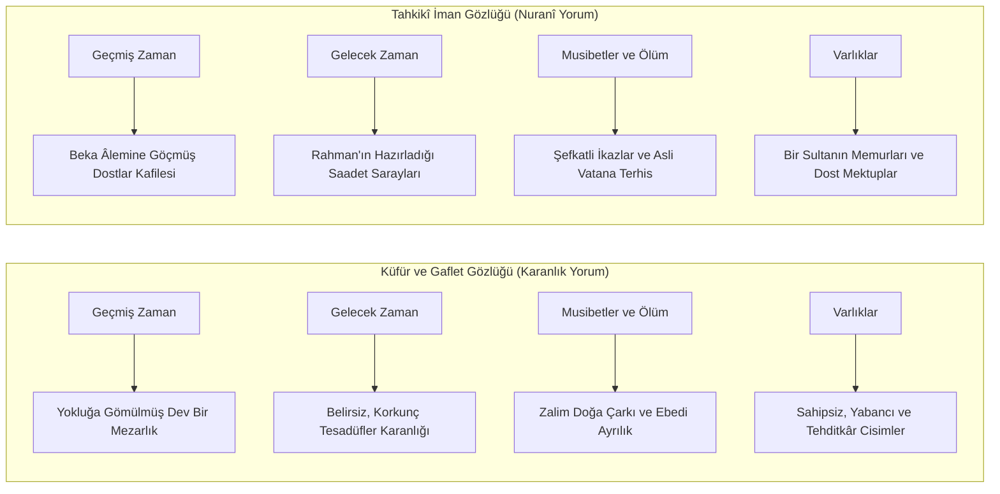

# ⚖️ Modül 01: İman ve Küfür Muvazeneleri (Anlam ve Saadet Analizi)

> *"İman tevhidi, tevhid teslimi, teslim tevekkülü, tevekkül saadet-i dareyni iktiza eder."*  
> **— 23. Söz**

---

## 🎯 Modülün Amacı

Modern insanın en derin yarası **anlamsızlık (nihilizm)** ve **varoluşsal kaygıdır**. İmkânlar, konfor ve hız tarihin hiçbir döneminde olmadığı kadar arttı; fakat antidepresan kullanımı, yalnızlık ve ruhsal tükenmişlik de aynı oranda tavan yaptı. Neden? Çünkü insan ruhu sonsuzluk için kodlanmışken, ona geçici ve tesadüfi bir madde dünyası dayatılıyor.

Risale-i Nur'un en çarpıcı metodolojilerinden biri **Muvazene (Karşılaştırmalı Analiz)** yöntemidir: İman sadece ahirette cenneti kazandırmaz; **daha bu dünyada iken insanın kalbinde manevi bir cennet çekirdeği taşır.** Küfür ve gaflet ise sadece ahirette değil, **daha bu dünyada iken ruhu manevi bir cehennem azabı içinde bırakır.**

Bu modülde, iman gözlüğü ile inançsızlık/gaflet gözlüğünün kâinatı, geçmişi, geleceği, acıyı ve ölümü nasıl bambaşka iki gerçekliğe dönüştürdüğünü aklî delillerle inceleyeceğiz.

---

## 🔭 İki Bakış Açısının Karşılaştırmalı Matrisi

---

## 📚 Bu Modüldeki Dersler

1. **[Ders 01: İlk Sekiz Söz Yolculuğu (Küçük Sözler)](./01-ilk-sekiz-soz-yolculugu.md)**  
   *1. Söz'den (Bismillah'ın sırrı) 8. Söz'e (Kuyu temsili ve dinin mahiyeti) kadar uzanan sekiz temel hakikat basamağıyla kâinatı korku tünelinden emniyet sarayına dönüştürmek.*
2. **[Ders 02: Kur'an Hikmeti ve Materyalist Felsefe Muvazenesi](./02-kuran-ve-felsefe-muvazenesi.md)**  
   *12., 13. ve 23. Sözler ışığında vahiy ile seküler felsefenin insan tanımı, hayat gayesi ve lezzet/elem denkleminin derin karşılaştırması.*

---

## 🔬 Nefis Muhasebesi (Self-Check)

1. Başımıza beklenmedik bir kriz geldiğinde ilk tepkimiz *"Neden hep benim başıma geliyor, her şey kontrolden çıktı!"* paniği mi oluyor, yoksa *"Rabbim bu hadiseyle bana ne öğretmek istiyor?"* tevekkülü mü?
2. Geçip giden gençliğimize ve vefat eden sevdiklerimize baktığımızda içimizi karanlık bir hiçlik mi kaplıyor, yoksa kavuşma ümidi mi?
3. İbadeti sırtımıza yüklenmiş ağır bir borç gibi mi görüyoruz, yoksa ruhumuzun nefes aldığı bir şeref ve saadet kaynağı olarak mı?

---

## 🛠️ Günlük Pratik Uygulama

* **Günlük "Bismillah" Bilinci:** Bugün su içerken, yemeğe başlarken, bilgisayarını açarken veya evden çıkarken dil ucuyla değil, **1. Söz** bilinciyle *"Allah'ın adıyla, O'nun izni ve ikramıyla"* diyerek kâinat Sultanı ile irtibat kur.
* **Temel Kaynak Okuması:** *Sözler* külliyatından **1. Söz'den 8. Söz'e kadar (Küçük Sözler)** ve **23. Söz (Birinci Mebhas)** bölümlerini oku.

---

⬅️ **[Önceki Modül: 00 - Init: Niyet ve İhlas](../00-Init-Niyet-ve-Ihlas/README.md)** | ➡️ **[Sonraki Modül: 02 - Tevhid ve Ontoloji](../02-Tevhid-ve-Ontoloji/README.md)**
