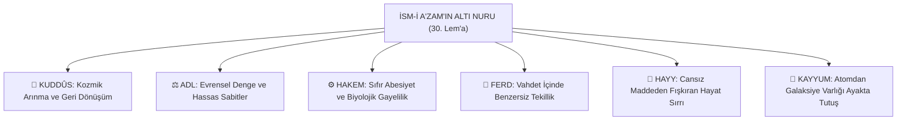

# 🌟 Ders 03: İsm-i A'zam'ın Altı Nuru ve Kâinatın Bilimsel Katmanları

> *"Kâinatın yüzünde ve zerratın cephesinde Esmâ-i Hüsna'nın nakışları okunur; her bir fen, bir İlahi ismin küllî tecellisini keşfeder ve tarif eder."*  
> **— 30. Lem'a (İsm-i A'zam Risalesi) & 20. Söz Özeti**

---

## 1. Bilim Yasalarının Gerçek Adı: Esmâ-i Hüsna

Modern eğitim sisteminde fizik, kimya, ekoloji ve biyoloji birbirinden kopuk formül yığınları gibi anlatılır. **30. Lem'a (Altı Nükte — İsm-i A'zam Risalesi)** ise muazzam bir ontolojik devrim yapar: Doğa bilimleriyle keşfettiğimiz evrensel sabitler ve döngüler, sahipsiz mekanik kurallar değil; **İsm-i A'zam'ın altı büyük nurunun (Kuddûs, Adl, Hakem, Ferd, Hayy, Kayyum) kâinat aynasındaki tecellileridir!**

---

## 2. Altı İlahi Nurun Kozmik ve Bilimsel Analizi

### 1. İsm-i Kuddûs — Küresel Ekoloji ve Geri Dönüşüm Sistemi (1. Nükte)
Yeryüzünde her gün milyarlarca canlı ölüyor, yapraklar çürüyor, okyanuslarda milyonlarca ton organik atık oluşuyor. Normal bir fabrikada veya şehirde temizlik ekipleri 1 hafta çalışmasa her yeri leş ve salgın hastalık kaplar!
* **Gözlem:** Peki milyarlarca canlıya ev sahipliği yapan şu dünya misafirhanesi neden hiç kokmuyor ve kirlenmiyor?
* **Mekanizma:** Bulutlar sünger gibi su serpiyor; rüzgârlar süpürge gibi zararlı gazları dağıtıyor; karıncalar, bakteriler, mantarlar ve yırtıcı kuşlar **"sıhhiye memurları"** gibi ölü dokuları anında temizleyip toprağa besin olarak geri kazandırıyor; akciğerlerimizdeki alveoller ve böbreklerimiz kanımızı her dakika yıkıyor!
* **Hakikat:** Bu muazzam kozmik ve biyolojik temizlik döngüsü, **Kuddûs** (Her türlü kirden ve noksandan münezzeh, temizleyen) isminin tecellisidir. İnsanın abdestle, tövbeyle ve ahlak temizliğiyle bu evrensel zikre katılması kulluğun gereğidir!

### 2. İsm-i Adl — Hassas Ayar (`Fine-Tuning`) ve Termodinamik Denge (2. Nükte)
Astrofizikte **Hassas Ayar (`Fine-Tuning`)** olarak bilinen gerçek şudur: Kütleçekim sabiti, elektromanyetik kuvvet veya elektron-proton kütle oranı trilyonda bir oranında bile farklı olsaydı ne yıldızlar oluşabilir ne de karbon temelli hayat var olabilirdi!
* Güneşin merkezkaç kuvveti ile çekim kuvveti arasındaki hassas mizan,
* Atmosferdeki %21 oksijen oranı (biraz artsa ormanlar kendiliğinden yanar, biraz azalsa canlılar boğulur!),
* Ekosistemdeki av-avcı nüfus dengesi,  
bütün varlığı hassas bir terazide tutan **Adl (Mutlak Denge ve Adalet Sahibi)** isminin imzasıdır. Kâinatta bir atomun bile hakkını ve ölçüsünü şaşırmayan bu Adalet, elbette insanın amellerini de Mahkeme-i Kübra'da tartacaktır!

### 3. İsm-i Hakem / Hakîm — Genetik Kod ve Sıfır İsraf (3. Nükte)
İnsan vücudundaki yüzlerce kemikten, göz kapağındaki kirpiğin açısına, bir arının altıgen petek geometrisine (en az balmumuyla en geniş hacmi üreten matematiksel optimum!) kadar her organ ve her hücrede **çok katmanlı faydalar ve gayeler** kodlanmıştır.
* Eskiden materyalist biyologların "işlevsiz çöp DNA (`junk DNA`)" veya "körelmiş organ" sandığı yapıların bile bugün gen regülasyonu ve bağışıklık sisteminde hayati görevler üstlendiği anlaşılmaktadır!
* Şuursuz atomların "fayda ve gaye" gözetmesi imkânsız olduğuna göre, bu kusursuz mühendislik **Hakem ve Hakîm** isminin açık burhanıdır.

### 4. İsm-i Ferd — Evrensel Protokol ve Biyometrik Tekillik (4. Nükte)
Bütün canlıların DNA alfabesi aynı dört harfle (`A, T, G, C`) yazılmıştır: Bu, Yaratıcı'nın **birliğini (`Vahidiyet`)** gösterir. Ama aynı dört harften yazılan milyarlarca insanın hiçbirinin parmak izi, ses frekansı, göz retinası ve karakteri bir diğerinin kopyası değildir: Bu da her bir ferdin özel bir iradeyle tek tek yaratıldığını (**`Ferd` isminin Ehadiyet mührünü**) ispatlar!

### 5. İsm-i Hayy — Hayatın İndirgenemez Mucizesi (5. Nükte)
Laboratuvarda karbon, hidrojen, oksijen, azot ve fosfor elementlerinin tamamını bir tüpe koyup istediğiniz kadar elektrik ve ısı verin; kendi kendine yaşayan, hisseden, rızkını arayan tek bir canlı hücre üretemezsiniz (**Biyogenez Yasası**)!
* Hayat, maddenin bir yan ürünü değil; **Hayy-ı Ezelî** olan Allah'ın cansız toprağa vurduğu en parlak nuranî mühürdür. Hayat olmazsa kâinat karanlık ve anlamsız bir taş yığınından ibaret kalır; kâinat ağacının en süzülmüş meyvesi **hayat**, hayatın özü **ruh ve şuur**, şuurun meyvesi ise **iman ve şükürdür!**

### 6. İsm-i Kayyum — Kuantumdan Kozmosa Varlığın Devamı (6. Nükte)
Bir binayı usta yaptıktan sonra çekip gitse bina bir süre ayakta durabilir; fakat kâinat **statik bir bina değil, dinamik bir akıştır!**
* Elektronlar çekirdek etrafında saniyede katrilyonlarca devir yaparken, dünya saniyede ~30 km hızla güneş etrafında koşarken, kalbimiz biz uyurken bile hiç durmadan kan pompalarken; bu sistemten **Kayyum** (Her şeyi her an ayakta tutan) isminin tecellisi **saniyenin binde biri kadar çekilse**, atomlardan galaksilere kadar bütün evren bir anda dağılıp hiçliğe dökülür (*Fâtır, 41*)!

---

## 📝 Ders Özeti ve Eylem Adımları

1. Bugün aynaya baktığında simandaki **Ferd** mührünü, nefes alıp verdiğinde **Hayy** mührünü, ayağının altındaki dünyanın sarsılmadan akışında **Kayyum** ve **Adl** mührünü şuurlu olarak zikret.
2. **Kaynak Okuma:** *Lem'alar*, **30. Lem'a (Altı Nükte — İsm-i A'zam Risalesi)**.

---

⬅️ **[Önceki Ders: Otuz Üç Pencereden Tevhid](./02-otuz-uc-pencere-tevhid.md)** | ➡️ **[Sonraki Modül: 03 - Enaniyet ve Bilişsel Filtreler](../03-Enaniyet-ve-Bilisel-Filtreler/README.md)**
