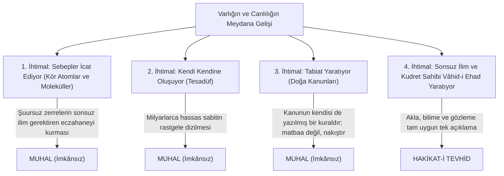

# 🌌 Modül 02: Tevhid ve Ontoloji (Kâinatın Kaynak Kodunu Okumak)

> *"Kâinatta hiçbir zerre yoktur ki, hadsiz hikmetleriyle Sâni'in vücub-u vücuduna ve vahdetine şehadet etmesin."*  
> **— 22. Söz**

---

## 🎯 Modülün Amacı

Çağımızın en yaygın zihinsel yanılsaması, bir sistemin **işleyiş mekanizmasını keşfetmeyi**, o sistemin **Yaratıcısına ihtiyaç kalmadığı** şeklinde yorumlamaktır. Yerçekimi yasasını formülleştirmek gezegenleri kimin o hassas yörüngede tuttuğu sorusunu ortadan kaldırmaz; tıpkı bir yazılımın kaynak kodundaki fonksiyonları okumanın "bu kodu yazan bir mühendis yoktur" anlamına gelmemesi gibi!

Bu modül, materyalist ve natüralist ontolojinin sığındığı üç temel iddiayı (**Sebepler yaratıyor**, **Kendi kendine tesadüfen oluşuyor**, **Tabiat gerektiriyor**) mantıksal olarak çürütür ve atomdan galaksilere kadar her varlıkta parlayan **Vahdet (Birlik)** ve **Ehadiyet (Her bir şeyde doğrudan tecelli)** mühürlerini okutur.

---

## 🔍 Ontolojik Karar Ağacı (23. Lem'a Mantık Çerçevesi)

Var olan muhteşem sanatlı bir eserin (örneğin bir hücrenin, bir gözün veya bir insanın) meydana gelmesi için aklen yalnızca **dört ihtimal** düşünülebilir:

---

## 📚 Bu Modüldeki Dersler

1. **[Ders 01: Tabiat Risalesi Analizi — Üç Muhalin Çöküşü](./01-tabiat-risalesi-analizi.md)**  
   *23. Lem'a (Tabiat Risalesi) ışığında sebepler, tesadüf ve tabiat kavramlarının mantıksal otopsisi; Eczahane-i Kübra ve Matbaa analojileri.*
2. **[Ders 02: Otuz Üç Pencereden Vahdet ve Ehadiyet Mührü](./02-otuz-uc-pencere-tevhid.md)**  
   *22. Söz ve 33. Söz (Pencereler) ışığında Mânâ-yı Harfî okuması, Tevhid-i Hakiki ve kâinat çapındaki yardımlaşma (Teavün) yasası.*

---

## 🔬 Nefis Muhasebesi (Self-Check)

1. Günlük konuşmalarımda *"Doğa bunu harika evrimleştirmiş / Tabiat ana cömert davranmış / Şans eseri kurtulduk"* gibi şuursuz sebeplere rububiyet (yaratıcılık ve idarecilik) veren kalıpları farkında olmadan kullanıyor muyum?
2. Bir bilimsel makale veya belgesel izlediğimde hayranlığım mekanizmanın kendisinde mi takılıp kalıyor (*mânâ-yı ismî*), yoksa o mekanizmayı kuran Sonsuz İlim Sahibine mi yükseliyor (*mânâ-yı harfî*)?

---

## 🛠️ Günlük Pratik Uygulama

* **Mânâ-yı Harfî Egzersizi:** Bugün çevrende gördüğün bir canlıyı (bir arıyı, bir yaprağı veya kendi elini) 2 dakika boyunca incele: Yapıldığı ham maddelerin (karbon, hidrojen, oksijen, toprak, su) ne kadar şuursuz olduğunu, buna karşılık ortaya çıkan tasarımın ne kadar şuurlu ve hikmetli olduğunu mukayese et.
* **Temel Kaynak Okuması:** *Lem'alar*, **23. Lem'a (Tabiat Risalesi)** ve *Sözler*, **22. Söz**.

---

⬅️ **[Önceki Modül: 01 - İman ve Küfür Muvazeneleri](../01-Iman-ve-Kufur-Muvazeneleri/README.md)** | ➡️ **[Sonraki Modül: 03 - Enaniyet ve Bilişsel Filtreler](../03-Enaniyet-ve-Bilisel-Filtreler/README.md)**
