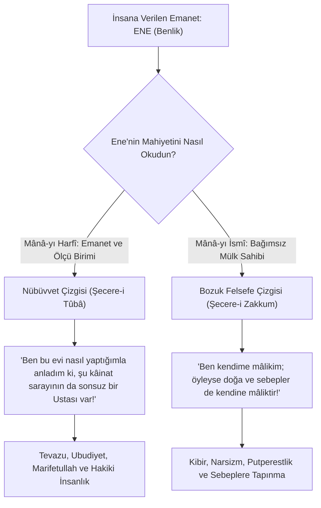

# 🪞 Modül 03: Enaniyet ve Bilişsel Filtreler (Ene ve Zerre Analizi)

> *"Ene, künûz-u mahfiye olan esmâ-i İlâhiyenin anahtarı olduğu gibi, kâinatın tılsım-ı muğlâkının dahi anahtarı olarak bir muammâ-yı müşkilküşâdır, bir tılsım-ı hayretfezâdır."*  
> **— 30. Söz (Ene Bahsi)**

---

## 🎯 Modülün Amacı

Neden aynı kâinata bakan iki zeki insandan biri her zerrede Allah'ın sanatını görürken, diğeri kibirle her şeyi tesadüfe veya insan aklına mal eder? Aradaki fark dış dünyadaki verilerde değil, **zihindeki bilişsel filtrede (`Ene` / Benlik algısında)** yatmaktadır!

Kur'an-ı Kerim'de göklerin, yerin ve dağların yüklenmekten çekindiği, insanın ise yüklendiği bildirilen **"Emanet"**in (Ahzab, 72) en önemli bir ferdi **"Ene" (Benlik)**dir. 

Bu modül, insan psikolojisinin ve epistemolojisinin en derin sırrını çözer:
* **"Ene"** gerçek bir mülkiyet değil, Yaratıcı'nın sonsuz sıfatlarını anlayabilmemiz için bize verilmiş **farazî bir ölçü birimidir (Vahid-i Kıyasî / Referans API'si).**
* Doğru kullanıldığında insanı marifetullahın zirvesine (**Şecere-i Tûbâ**) çıkarır; yanlış kullanıldığında ise narsizme, şirke ve maddeperestliğe (**Şecere-i Zakkum**) sürükler!

---

## 🌳 Ene'nin İki Çatallı Yolu (30. Söz Şeması)

---

## 📚 Bu Modüldeki Dersler

1. **[Ders 01: Ene — İlahi Hazinelerin Anahtarı mı, Karanlık Perde mi?](./01-ene-anahtar-mi-perde-mi.md)**  
   *30. Söz (Birinci Maksat) ışığında "Vahid-i Kıyasî" kavramı, benliğin ince bir telden kalın bir kibir duvarına dönüşme süreci ve nübüvvet-felsefe çatallaşması.*
2. **[Ders 02: Tahavvülat-ı Zerrat ve Esmâ Perdeleri](./02-zerre-ve-esma-tecellileri.md)**  
   *30. Söz (İkinci Maksat) ve 24. Mektup ışığında atom altı dünyadaki baş döndürücü hareketin hikmetleri ve perdeler arkasındaki şefkatli tecelliler.*

---

## 🔬 Nefis Muhasebesi (Self-Check)

1. Bir başarı elde ettiğimde (iyi bir kod yazdığımda, zor bir sınavı geçtiğimde, güzel bir iş çıkardığımda) içimdeki ilk ses *"Ben yaptım, zekâmla başardım!"* mı diyor, yoksa *"Rabbim lütfetti, aklıma ve elime bu nimeti ihsan etti"* mi?
2. Eleştirildiğimde savunmaya geçip öfkelenmemin altında hakikati koruma endişesi mi var, yoksa incinen **enaniyetim (egom)** mu?

---

## 🛠️ Günlük Pratik Uygulama

* **Vahid-i Kıyasî Dönüşümü:** Bugün sahip olduğun bir yeteneği (bilgi, merhamet, sanat zevki veya güç) düşün ve şu cümleyi kur: *"Bendeki şu küçücük ilim kırıntısı bile kendi kendine olmadıysa, bütün kâinatı kuşatan Sonsuz İlim ne kadar muazzamdır! Mülk de, ilim de yalnız O'nundur."*
* **Temel Kaynak Okuması:** *Sözler*, **30. Söz (Birinci ve İkinci Maksat)** ve *Mektubat*, **24. Mektup**.

---

⬅️ **[Önceki Modül: 02 - Tevhid ve Ontoloji](../02-Tevhid-ve-Ontoloji/README.md)** | ➡️ **[Sonraki Modül: 04 - Eskatoloji: Diriliş Algoritması](../04-Eskatoloji-Dirilis-Algoritmasi/README.md)**
