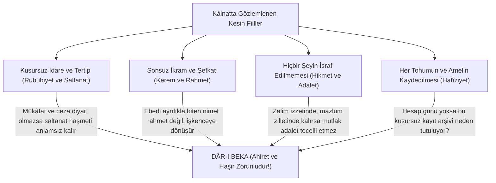

# 🌱 Modül 04: Eskatoloji ve Diriliş Algoritması (Haşir ve Beka Hakikati)

> *"Şimdi bak Allah'ın rahmet eserlerine: Yeryüzünü ölümünün ardından nasıl diriltiyor! Şüphesiz O, ölüleri de kesinlikle diriltecektir. O her şeye hakkıyla kadirdir."*  
> **— Rûm Suresi, 50. Ayet (10. Söz'ün Serlevhası)**

---

## 🎯 Modülün Amacı

İbn-i Sina gibi büyük bir dâhinin bile *"Haşir akıl ile kavranamaz, yalnız imanla teslim olunur"* dediği yeniden diriliş ve ahiret meselesini, Bediüzzaman Said Nursi **10. Söz (Haşir Risalesi)** ve **29. Söz** ile yirmi iki kere iki dört eder kat'iyetinde **aklî, mantıkî ve gözlemsel delillerle** ispat etmiştir!

İnsanın en derin travması **ölümü bir "yok oluş" (`system shutdown / permanent delete`) zannetmesidir.** Sevdiklerinin toprağa karışıp hiçliğe gideceği düşüncesi insan ruhunu felç eder. Bu modül, kâinattaki İlahi isimlerin tecellilerinden ve her bahar gözümüzün önünde gerçekleşen 300.000 türün yeniden dirilişinden hareketle; **ölümün idam değil, mekan değişikliği ve ebedi vatana terhis tezkeresi olduğunu** ispatlar.

---

## 🔄 İlahi İsimlerden Ahirete Çıkarım Matrisi (10. Söz Mimarisi)

---

## 📚 Bu Modüldeki Dersler

1. **[Ders 01: Haşir Risalesi — On İki Hakikat ve Bahar Numunesi](./01-hasir-risalesi-on-iki-hakikat.md)**  
   *10. Söz ışığında İlahi isimlerin (Rab, Kerîm, Hakîm, Adl, Mucîb, Hafîz, Muhyî) ahireti nasıl zaruri kıldığı ve her bahar yaşanan küçük kıyamet-haşir simülasyonu.*
2. **[Ders 02: Ruhun Bekası, Melekler ve Boyutlar Ötesi Varlık](./02-ruhun-bekasi-ve-melekler.md)**  
   *29. Söz ışığında ruhun bedenden bağımsız cevher oluşu, ölümsüzlüğü, meleklerin varlığının aklî zarureti ve madde ötesi hayat mertebeleri.*

---

## 🔬 Nefis Muhasebesi (Self-Check)

1. Bir cenaze gördüğümde veya mezarlığın yanından geçtiğimde zihnim konuyu hızla kapatıp kaçmaya mı çalışıyor, yoksa orayı ebedi alemin bekleme salonu olarak tefekkür edebiliyor muyum?
2. Dünyada uğradığım bir haksızlık veya çektiğim bir zahmet karşısında **Mahkeme-i Kübra**'nın şaşmaz adaletini hatırlayarak kalbimi teskin edebiliyor muyum?

---

## 🛠️ Günlük Pratik Uygulama

* **Bahar ve Tohum Tefekkürü:** Kışın kupkuru bir odun parçası gibi duran ağaçların baharda birkaç hafta içinde milyonlarca çiçek ve meyveyle donanmasını izle (veya düşün): Kuru odundan binlerce nar ve şeftaliyi geçen seneki kayıtlarıyla birebir dirilten Kudret'e, çürümüş kemikleri yeniden diriltmek ağır gelir mi?
* **Temel Kaynak Okuması:** *Sözler*, **10. Söz (Mukaddime ve On İki Hakikat)** ve **29. Söz**.

---

⬅️ **[Önceki Modül: 03 - Enaniyet ve Bilişsel Filtreler](../03-Enaniyet-ve-Bilisel-Filtreler/README.md)** | ➡️ **[Sonraki Modül: 05 - Hata Ayıklama ve Vesvese](../05-Hata-Ayiklama-Vesvese/README.md)**
