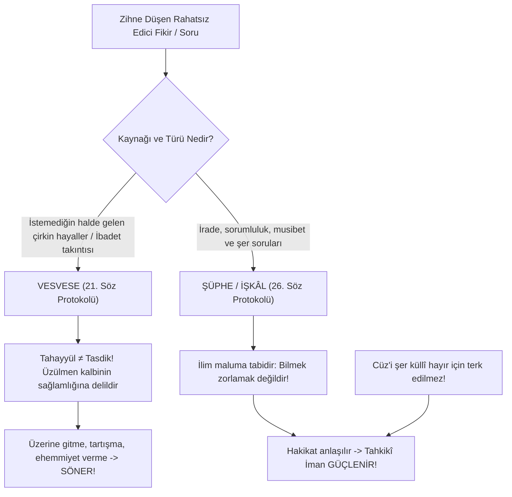

# 🐞 Modül 05: Hata Ayıklama ve Vesvese (Şüphe, Kader ve Şer Problemi)

> *"Ey maraz-ı vesvese ile mübtela! Biliyor musun vesvesen neye benzer? Musibete benzer. Ehemmiyet verdikçe şişer, ehemmiyet vermezsen söner."*  
> **— 21. Söz (İkinci Makam — Vesvese Risalesi)**

---

## 🎯 Modülün Amacı

En sağlam yazılmış sistemlerde bile dışarıdan gelen hatalı paketler (`malformed packets`), gürültü sinyalleri veya yanlış anlaşılan istisnalar (`exceptions`) sistemi kilitleyebilir — eğer doğru bir **Hata Ayıklama (`Debugging`) ve İstisna Yönetimi (`Exception Handling`)** mekanizmanız yoksa!

İman yolcusunun zihnine de zaman zaman iki büyük kanaldan sarsıntı gelir:
1. **Psikolojik / Şeytanî Kanal (Vesvese):** Namazda, abdestte veya bizzat mukaddesat hakkında hayale hücum eden çirkin görüntüler, şüphe fısıltıları ve *"Eyvah, kalbim bozuldu, imanım mı gitti?"* paniği.
2. **Felsefî / Kelâmî Kanal (Kader ve Kötülük Problemi):** *"Allah her şeyi önceden biliyor ve yazdıysa benim suçum ne?"* ve *"Sonsuz merhametli bir Yaratıcı varsa dünyada neden savaşlar, hastalıklar, depremler ve şeytan var?"* soruları.

Bu modül, bu iki çetin düğümü korkuyla bastırarak değil; **psikolojik, mantıksal ve kelâmî anatomisini çıkararak** berraklıkla çözer!

---

## 🛠️ Manevi Debugging Akış Şeması

---

## 📚 Bu Modüldeki Dersler

1. **[Ders 01: Vesvesenin Teşhisi ve Kesin Tedavisi](./01-vesvese-teshisi-ve-tedavisi.md)**  
   *21. Söz (İkinci Makam) ışığında vesvesenin beş yarasına beş kat'i merhem; hayal ile kalbin tasdiki arasındaki kritik fark ve OKB/takıntı döngüsünü kırmak.*
2. **[Ders 02: Kader, Cüz'î İrade ve Kötülük (Şer) Problemi](./02-kader-cuz-i-irade-ve-ser-problemi.md)**  
   *26. Söz (Kader Risalesi) ve Şeytanın İcadı bahisleri ışığında ezelî ilim, insan özgürlüğü, musibetlerin hikmeti ve "Her şeyde bir güzellik ciheti" yasası.*

---

## 🔬 Nefis Muhasebesi (Self-Check)

1. Aklıma istem dışı gelen olumsuz bir düşünceyi "benim kendi inancım" sanıp kendimi suçluyor ve ümitsizliğe mi kapılıyorum?
2. Kendi hatalarımda *"Kaderim böyleymiş"* diyerek sorumluluktan kaçıp, başarılarımda *"Ben kazandım"* diyerek kadere karşı övünüyor muyum?

---

## 🛠️ Günlük Pratik Uygulama

* **Vesvese Karşısında "Ignore" Kuralı:** Zihnine ibadet veya imanla ilgili takıntılı bir fısıltı geldiğinde onunla kavga etme, onu inceleme; gülümseyip *"İstiâze"* (*Eûzü billâhi mine'ş-şeytâni'r-racîm*) çek ve işine devam et.
* **Temel Kaynak Okuması:** *Sözler*, **21. Söz (İkinci Makam)**, **26. Söz (Kader Risalesi)** ve *Lem'alar*, **13. Lem'a**.

---

⬅️ **[Önceki Modül: 04 - Eskatoloji: Diriliş Algoritması](../04-Eskatoloji-Dirilis-Algoritmasi/README.md)** | ➡️ **[Sonraki Modül: 06 - Runtime: Günlük Tefekkür](../06-Runtime-Gunluk-Tefekkur/README.md)**
