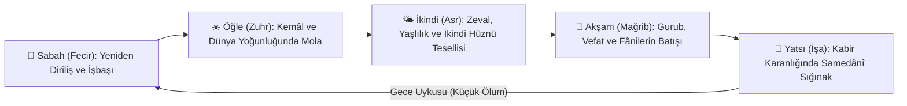

# ⚡ Modül 06: Runtime — Günlük Tefekkür, Namaz ve Sünnet-i Seniyye

> *"Namaz, kulun kendi acz ve fakrını ilân edip, Kadîr-i Zülcelâl'in kudret ve rahmetine sığınmasıdır; bütün ibadetlerin fihristesi ve kâinatın tesbihatının hulâsasıdır."*  
> **— 9. Söz Özeti**

---

## 🎯 Modülün Amacı

Derlenmiş ama çalıştırılmamış (`never executed`) bir yazılım diskin bir köşesinde atıl durmaya mahkûmdur. İman hakikatleri de sadece zihinde entelektüel birer teori olarak kalır, **günlük çalışma zamanına (`Runtime` — Namaz, Dua, Aktif Tefekkür ve Sünnet-i Seniyye)** dökülmezse dünya hayatının gürültüsü içinde zamanla aşınır!

Bu modül, önceki beş modülde inşa ettiğimiz tahkikî iman mimarisini **24 saatlik gerçek hayat döngüsüne nasıl entegre edeceğimizi** gösterir:
1. Neden namaz günde tam **beş vakit** ve belirli kozmik dönüşüm anlarına yerleştirilmiştir?
2. Kâinat Seyyahı gibi sokağa çıktığımızda buluttan rüzgâra, ağaçtan denize kadar her varlığı nasıl canlı bir Kur'an ayeti gibi okuruz (**Âyetü'l-Kübra**)?
3. **Dua** ve **Sünnet-i Seniyye**, sıradan alışkanlıklarımızı (uyumak, yemek, yürümek, çalışmak) nasıl kesintisiz bir ibadete dönüştürür?

---

## 🕰️ Günlük Ruhsal Kalibrasyon Döngüsü (9. Söz Runtime Mimarisi)

---

## 📚 Bu Modüldeki Dersler

1. **[Ders 01: Namazın Beş Vakit Sırrı ve Huşu Rehberi](./01-namazin-bes-vakit-sirri.md)**  
   *4., 9. ve 21. Sözler (Birinci Makam) ışığında beş vaktin kozmik ve psikolojik hikmeti; namaza üşenme nefsaniyetini kıran beş kesin ilaç ve Sübhanallah-Elhamdülillah-Allahu Ekber çekirdekleri.*
2. **[Ders 02: Âyetü'l-Kübra Tefekkürü, Dua Sırrı ve Sünnet Pusulası](./02-ayetel-kubra-ve-sitte-i-sunnet.md)**  
   *7. Şua (Âyetü'l-Kübra), 23. Söz (Dua Bahsi) ve 11. Lem'a (Mirkatü's-Sünne) ışığında kâinat okuması, kabul olunmayan dua yanılgısının tashihi ve Sünnet-i Seniyye'nin sıradan anları altına çeviren kimyası.*

---

## 🔬 Nefis Muhasebesi (Self-Check)

1. Namaza durduğumda zihnim dünyevi bildirimlerle dolu bir "otomatik pilot" modunda mı kılıyor, yoksa kimin huzurunda durduğumu hissederek mi tekbir alıyorum?
2. Dua ederken sadece başım sıkıştığında "sipariş listesi" verir gibi mi el açıyorum, yoksa duanın bizzat kendisinin en tatlı yakınlık ve kulluk olduğunu biliyor muyum?

---

## 🛠️ Günlük Pratik Uygulama

* **Beş Vakit Çapa (Anchor) Uygulaması:** Bugün her ezan okunduğunda elindeki işi 30 saniyeliğine bırak; o vaktin hangi ömür ve kâinat sahnesini (doğum, gençlik, ihtiyarlık, ölüm, kabir) hatırlattığını düşünerek abdeste yönel.
* **Temel Kaynak Okuması:** *Sözler*, **9. Söz**, **21. Söz (Birinci Makam)**; *Lem'alar*, **11. Lem'a**; *Şualar*, **7. Şua (Âyetü'l-Kübra — Birinci Bab)**.

---

⬅️ **[Önceki Modül: 05 - Hata Ayıklama ve Vesvese](../05-Hata-Ayiklama-Vesvese/README.md)** | ➡️ **[Sonraki Modül: 07 - Hayati ve İçtimai Rehberler](../07-Hayati-ve-Ictimai-Rehberler/README.md)**
