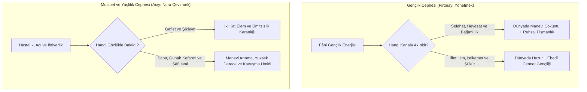

# 🏥 Modül 07: Hayati ve İçtimai Rehberler (Gençlik, Hastalık ve İhtiyarlık Reçeteleri)

> *"Gençlik hiç şüphe yok ki gidecek. Yaz güze ve kışa yer vermesi ve gündüz akşama ve geceye değişmesi kat'iyetinde, gençlik dahi ihtiyarlığa ve ölüme değişecek. Eğer o fâni ve geçici gençliğini iffetle hayrata istikamet dairesinde sarf etse, onunla ebedî, bâkî bir gençliği kazanacağını bütün semavî fermanlar müjde veriyorlar."*  
> **— Gençlik Rehberi**

---

## 🎯 Modülün Amacı

Hakikat yolculuğu steril bir laboratuvarda geçmez! Yolcunun karşısına iki büyük imtihan cephesi çıkar:
1. **Gençlik ve Şehvet/Sefahet Kasırgası:** Duyguların en coşkun, algoritmaların ve ekranların nefsi saniye başı tahrik ettiği, yarını düşünmeyen hislerin aklı esir almaya çalıştığı fırtınalı dönem.
2. **Hastalık, Musibet, Kayıp ve İhtiyarlık Kışı:** Bedenin zayıfladığı, acıların kapıyı çaldığı, yalnızlık ve çaresizlik hissinin ruhu kuşattığı kırılgan dönemler.

Risale-i Nur bu her iki cephe için de soğuk vaazlar değil, **yaranın tam üzerine basan şefkatli bir manevi eczane** (*Gençlik Rehberi*, *Hastalar Risalesi*, *İhtiyarlar Risalesi*) sunar!

---

## 🧭 Hayat Evreleri ve Manevi Dönüşüm Haritası

---

## 📚 Bu Modüldeki Dersler

1. **[Ders 01: Gençlik Rehberi ve Dijital Asrın İmtihanı](./01-genclik-rehberi-ve-asrin-imtihani.md)**  
   *Gençlik Rehberi ışığında kör hissiyatın aklı nasıl aldattığı, gayrimeşru lezzetlerin dünyevi-uhrevi zehirleri, ekran/dopamin tuzaklarına karşı iffet kalkanı.*
2. **[Ders 02: Hastalar ve İhtiyarlar Tesellisi — Acının İçindeki Rahmet](./02-hastalar-ve-ihtiyarlar-tesellisi.md)**  
   *2. Lem'a (Hz. Eyyüb Kıssası), 25. Lem'a (Hastalar Risalesi) ve 26. Lem'a (İhtiyarlar Risalesi) ışığında hastalıkların manevi sabun oluşu ve yaşlılığın ebedi bahar müjdesi.*

---

## 🔬 Nefis Muhasebesi (Self-Check)

1. Kısa vadeli bir haz (haram bir bakış, öfkeli bir söz, saatlerce amaçsız ekran kaydırma) uğruna uzun vadeli kalp huzurumu ve manevi enerjimi feda ediyor muyum?
2. Bir hastalık veya sıkıntı anında sabırsızlıkla isyan mı ediyorum, yoksa geçmiş günahlarımın döküldüğü ve derecemin yükseldiği bir arınma fırsatı olduğunu hatırlayabiliyor muyum?

---

## 🛠️ Günlük Pratik Uygulama

* **Şefkat Ziyareti / Mesajı:** Bugün hasta olan bir tanıdığını veya yaşlı bir büyüğünü (anneanne, dede, akraba, komşu) ara yahut ziyaret et; ona dualarının ne kadar kıymetli olduğunu hatırlatarak gönlünü al.
* **Temel Kaynak Okuması:** **Gençlik Rehberi (13. Söz İkinci Makam)**, *Lem'alar*'dan **2. Lem'a**, **25. Lem'a (Hastalar Risalesi)** ve **26. Lem'a (İhtiyarlar Risalesi)**.

---

⬅️ **[Önceki Modül: 06 - Runtime: Günlük Tefekkür](../06-Runtime-Gunluk-Tefekkur/README.md)** | ➡️ **[Kavramsal Sözlüğe Geç](../sozluk/README.md)**
