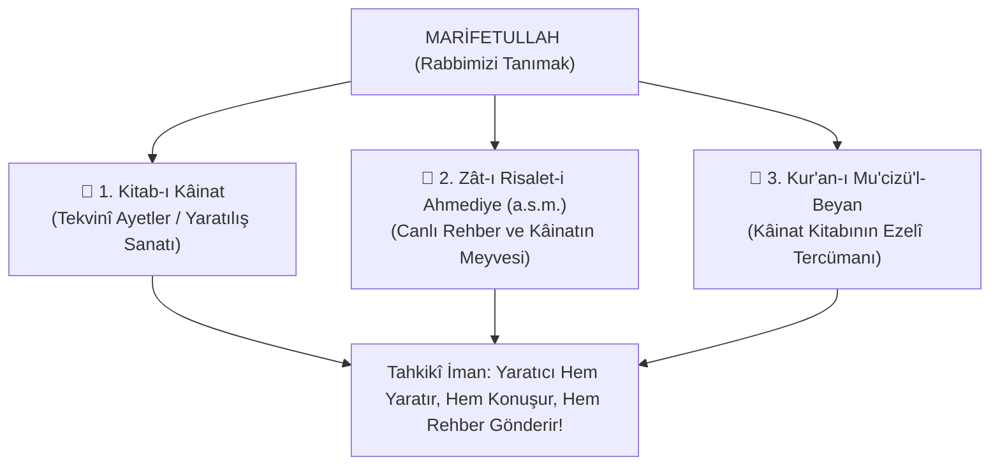

# 🕋 Modül 08: Nübüvvet ve İ'câz-ı Kur'an (Deizm Yanılgısına Cevap ve Üç Küllî Muarrif)

> *"Rabbimizi bize tarif eden üç büyük küllî muarrif var: Birisi şu kitab-ı kâinattır... İkincisi şu kitab-ı kebîrin âyet-i kübrâsı olan Hâtemü'l-Enbiya Aleyhissalâtü Vesselâm'dır. Üçüncüsü Kur'an-ı Azîmüşşan'dır."*  
> **— 19. Söz (Birinci Reşha)**

---

## 🎯 Modülün Amacı: "Yaratıcı Var Ama Peygambere ve Dine Gerek Yok!" (Deizm) İddiasının Çöküşü

Çağımızda materyalizmin "Evren tesadüfen oluştu" iddiası modern bilim (hassas ayar, DNA bilişimi, Big Bang) karşısında iflas edince, şüphe cephesi ikinci bir savunma hattına çekildi: **Deizm!**  
Deist zihin şöyle der: *"Tamam, bu muazzam kâinatın bir Yaratıcısı var; ama O kâinatı kurup kenara çekildi, insanlara peygamber veya kutsal kitap göndermesine gerek yok!"*

Risale-i Nur (**19. Söz**, **19. Mektup**, **20. Söz** ve **25. Söz**) bu iddiayı saf akıl ve sistem mantığıyla kökünden çürütür:
1. **Hiç mümkün müdür ki**, en küçük bir elektronik cihazı üreten mühendis bile yanına bir **kullanım kılavuzu (`documentation`)** ve bir **eğitmen** koyarken; şu uçsuz bucaksız kâinat sarayını ve insan gibi binlerce sırlı duyguyla donatılmış bir şaheseri yaratan Hakîm-i Zülcelal, insanı *"Nereden geldin? Nereye gidiyorsun? Vazifen nedir?"* sorularında karanlıkta ve rehbersiz bıraksın?!
2. Bütün karıncalara bir emir (kraliçe), bütün arılara bir ya'sub (başkan) ve bütün kuş sürülerine bir kılavuz veren İlahi Nizam, insanlık kafilesini peygambersiz ve kitapsız başıboş bırakır mı? **Asla!**

---

## 🔭 Üç Küllî Muarrif (Yaratıcı'yı Tanıtan Üç Evrensel Delil)

---

## 📚 Bu Modüldeki Dersler

1. **[Ders 01: Risalet-i Ahmediye Burhanları ve Deizmin Mantıksal Çöküşü](./01-risalet-i-ahmediye-burhanlari.md)**  
   *19. Söz ve 19. Mektup (Mucizat-ı Ahmediye) ışığında Hz. Muhammed'in (a.s.m.) doğruluğunun ve peygamberliğinin tarihsel, ahlaki, sosyolojik ve aklî ispatları.*
2. **[Ders 02: İ'câz-ı Kur'an ve Peygamber Mucizelerinin Bilim/Teknoloji Ufku](./02-icaz-i-kuran-ve-bilim-ufku.md)**  
   *25. Söz (Mucizat-ı Kur'aniye) ve 20. Söz (İkinci Makam) ışığında Kur'an'ın gençliğini hiç kaybetmeyen mucizeliği ve peygamber mucizelerinin beşer teknolojisinin nihai sınırlarını nasıl çizdiği.*

---

## 🔬 Nefis Muhasebesi (Self-Check)

1. Peygamber Efendimiz'i (a.s.m.) sadece tarihte yaşamış mübarek bir zat olarak mı anıyorum, yoksa hayatın her anında yolumu aydınlatan canlı bir rehber ve kâinatın en büyük muallimi olarak mı tanıyorum?
2. Kur'an-ı Kerim'i okurken onu sanki bugün ve doğrudan bana hitap eden ezelî bir İlahi ferman gibi dinleyebiliyor muyum?

---

## 🛠️ Günlük Pratik Uygulama

* **Salâvat Tefekkürü:** Bugün getirdiğin salâvatlarda (*"Allahümme salli alâ seyyidinâ Muhammed"*), seni karanlık hiçlik şüphelerinden kurtarıp kâinat Sultanı ile tanıştıran o Şefkatli Rehbere karşı duyduğun minneti kalbinde hisset.
* **Temel Kaynak Okuması:** *Sözler*, **19. Söz**, **20. Söz (İkinci Makam)**, **25. Söz** ve *Mektubat*, **19. Mektup**.

---

⬅️ **[Önceki Modül: 07 - Hayati ve İçtimai Rehberler](../07-Hayati-ve-Ictimai-Rehberler/README.md)** | ➡️ **[Sonraki Modül: 09 - Yapay Zekâ Çağında Nur'un İnkişafı](../09-AI-Caginda-Nurun-Inkisafi/README.md)**
