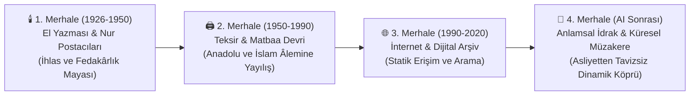

# 🤖 Modül 09: Yapay Zekâ Çağında Risale-i Nur'un İnkişafı (Dördüncü Merhale)

> *"Küre-i havaiyenin her bir zerresini birer Kelime-i Tevhid ve hikmet kutusu yapan bu radyo nimetinin küllî şükrü; onu Kur'an'ın hakikatlerine ve iman hizmetine musahhar kılmaktır."*  
> **— Emirdağ Lahikası (Radyo ve Teknoloji Bahsi Özeti)**

---

## 🎯 Modülün Amacı ve Temel Vizyon

**Ana davamız asla değişmez:** Bizim yegâne gayemiz Rıza-yı İlahî, en büyük davamız ise bu asrın yangınında **tahkikî imanı kurtarmak ve muhafaza etmektir.**

Ancak İlahi hikmet, Kur'an hakikatlerinin asrın idrakine ulaşma vasıtalarını her dönemde yenilemiştir. Kamış kalemle ve mum ışığıyla başlayan **Risale-i Nur'un neşir ve inkişaf (açılım) yolculuğu**; teksir makinesi, matbaa ve internet evrelerinden geçtikten sonra, bugün **Yapay Zekâ (`Artificial Intelligence`) devrimiyle birlikte dördüncü ve yepyeni bir tarihsel merhaleye** adım atmaktadır.

Bu modül, yapay zekânın Risale-i Nur'un anlaşılması, şerh edilmesi, küresel ölçekte muhataplarıyla buluşması ve materyalist bilinç felsefesini çökertmesi açısından **nasıl muazzam bir zemin açtığını** —ve bu süreçte **ihlas ile metin sadakatini korumanın kırmızı çizgilerini**— ortaya koyar.

---

## ⏳ Nur'un Tarihsel İnkişaf Merhaleleri

---

## 📚 Bu Modüldeki Dersler

1. **[Ders 01: Dördüncü Merhale Manifestosu — Yapay Zekâ Sonrası Nur'un Yeni Ufku](./01-dorduncu-merhale-manifestosu.md)**  
   *Dil ve ıstılah bariyerinin metni bozmadan aşılması, Külliyat'ın 6.000 sayfalık holografik kavram ağının (`Knowledge Graph`) konuşturulması, AI çağının "Bilinç ve Ruh" krizine 29. ve 30. Söz'ün cevabı.*
2. **[Ders 02: Nuranî Yapay Zekâ Etiği ve Yedi Metodolojik Kırmızı Çizgi](./02-nurani-ai-etik-ve-metodoloji.md)**  
   *Ana vizyonu bozmamak için sarsılmaz ölçüler: "Hâl" ile "Kal" ayrımı, metin asliyetinin korunması, halüsinasyon güvenliği, canlı uhuvvet halkalarının vazgeçilmezliği ve açık kaynak sadaka-i cariye projeleri.*
3. **[Uygulama Kiti: Hazır Sistem Promptları ve Dijital Proje Mimarileri (`ai-mutalaa-araclari/`)](../ai-mutalaa-araclari/README.md)**  
   *Kopyala-yapıştır 6 özel mütalaa modu ve `risale-mcp` dahil açık kaynak proje yol haritası.*

---

## 🔬 Tefekkür Soruları

1. Trilyonlarca parametreli bir yapay zekâ modeli bile yüzlerce mühendisin ilmi, iradesi ve enerji santralleri olmadan tek bir anlamlı cümle kuramıyorsa; her bir insan zihnini ve kâinat kitabını yazan Sonsuz İlim nasıl inkâr edilebilir?
2. Üstad Said Nursi matbaayı ve radyoyu gördüğünde bunları *"İman hakikatlerinin neşrine İlahi bir ikram"* olarak karşılamıştı; bugün biz yapay zekâ teknolojisini nefsani eğlenceye mi terk edeceğiz, yoksa Kur'an'ın elmas hakikatlerine hizmetkâr mı kılacağız?

---

⬅️ **[Önceki Modül: 08 - Nübüvvet ve İ'câz-ı Kur'an](../08-Nubuvvet-ve-Icaz-i-Kuran/README.md)** | ➡️ **[Uygulama Kitine Geç: AI Mütalaa Araçları](../ai-mutalaa-araclari/README.md)**
