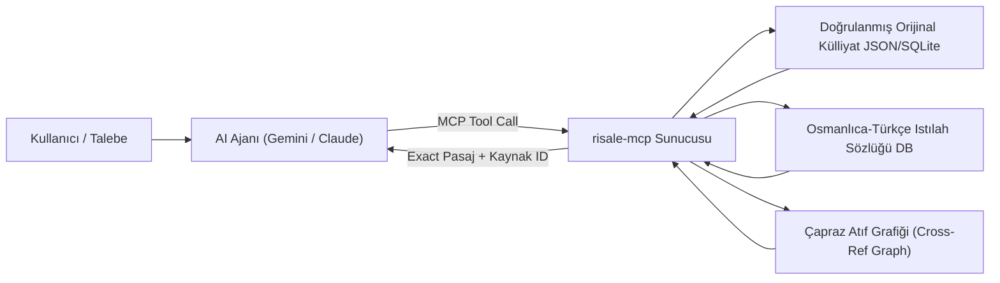

# 🏗️ 02: Dijital Sadaka-i Cariye Proje Yol Haritası (`Builders Roadmap`)

> *"Bir insan öldüğünde amel defteri kapanır; ancak üç şey müstesna: Sadaka-i cariye, kendisinden faydalanılan ilim ve kendisine dua eden hayırlı evlat."*  
> **— Hadis-i Şerif (Müslim, Vasiyyet, 14)**

Bu belge; yazılım mühendisleri, veri bilimciler, yapay zekâ araştırmacıları ve arayüz tasarımcıları için **Risale-i Nur'un Dördüncü Merhalesinde** inşa edilmeyi bekleyen **4 somut açık kaynak proje mimarisini** tanımlar. Bu projelerden herhangi birini başlatmak veya mevcut repoya modül olarak eklemek isteyen kardeşlerimiz Issue açarak ekip kurabilir!

---

## Proje 1: `risale-mcp` — Doğrulanmış Külliyat Model Context Protocol (MCP) Sunucusu

### Problem
Yapay zekâ ajanları (Claude Desktop, Cursor, Antigravity, VS Code Copilot vb.) kendi eğitim verilerinden Risale-i Nur alıntısı yapmaya çalıştığında kelimeleri karıştırabilmekte veya yanlış Söz/Lem'a numarası verebilmektedir.

### Çözüm Mimarisi
AI ajanlarına doğrudan **doğrulanmış, harfi harfine orijinal Külliyat veritabanından** okuma yeteneği kazandıran açık kaynak bir **MCP Sunucusu (`risale-mcp`)**:

### Önerilen MCP Araçları (`Tools`)
* `search_kulliyat(query, book_filter, semantic=True)`: Hem tam metin (`FTS5`) hem semantik vektör aramasıyla en ilgili orijinal paragrafları tam kitap/bölüm/sayfa referansıyla döndürür.
* `get_passage(book, chapter, section)`: Belirli bir Söz, Mektup veya Lem'a bölümünü tahrifsiz metin olarak getirir.
* `lookup_istilah(term)`: Kelimenin kökünü, lügat anlamını ve Risale-i Nur'daki özel ıstılahî tanımını döndürür.
* `get_related_passages(passage_id)`: Aynı hakikati şerh eden diğer Külliyat pasajlarını listeler.

---

## Proje 2: Esmâ-i Hüsna ve Kâinat Bilimleri Semantik Bilgi Grafiği (`Knowledge Graph`)

### Problem
Modern bilim verileri ile Esmâ-i Hüsna tecellileri arasındaki bağlantılar dağınık metinlerde kalmaktadır.

### Çözüm Mimarisi
`JSON-LD` / `Neo4j` tabanlı açık bir **Ontolojik Bilgi Grafiği**:
* **Düğümler (`Nodes`):** `İlahi İsim (ör. Kuddûs)` <-> `Kâinat Kanunu (ör. Azot/Karbon Döngüsü, Otofaji)` <-> `Risale Referansı (ör. 30. Lem'a 1. Nükte)` <-> `Kur'an Ayeti` <-> `Tefekkür Sorusu`.
* **Kullanım Alanı:** Öğrencilerin ve akademisyenlerin herhangi bir fen bilimi konusunu tıkladığında ilgili Esmâ tecellilerini ve Risale pasajlarını görsel bir galaksi ağında keşfedebildiği interaktif web uygulaması!

---

## Proje 3: İnteraktif "Temsilî Hikâyeler" Görsel Simülatörü (`Interactive Parables`)

### Problem
Yeni kuşak görsel ve etkileşimli deneyimlerle öğrenmeye alışkındır. Risale-i Nur'daki *Eczahane-i Kübra (23. Lem'a)*, *Derin Kuyu Temsili (8. Söz)*, *24 Altın Saati (4. Söz)*, *İki Yolcu (2. Söz)* ve *Tren/Zaman Tepesi (26. Söz)* temsilleri muazzam birer interaktif simülasyon potansiyeli taşır.

### Çözüm Mimarisi
HTML5 Canvas / Three.js / React ile çalışan, tarayıcıda tek tıkla açılan **etkileşimli mikro-deneyimler**:
* Örneğin *23. Lem'a Eczahane Simülasyonu*: Kullanıcının rastgele rüzgârla (tesadüfle) milyonlarca denemede tek bir anlamlı "hayat iksiri" veya anlamlı DNA dizisi oluşturma olasılığını canlı matematiksel sayaçla (`1 / 10^600`) deneyimlemesi!

---

## Proje 4: Külliyat Okuma ve Müzakere Arkadaşı (`Spaced Repetition & İstikrar Takibi`)

### Problem
*"Az ama devamlı oku"* düsturunu günlük telaş içinde sürdürmekte zorlanan gençler.

### Çözüm Mimarisi
Gizlilik odaklı (`local-first`), reklamsız, tamamen açık kaynak bir **30 Günlük Tahkikî İman Kampı Web/Mobil Uygulaması**:
* Günlük 15 dakikalık okuma pasajı + satır içi anlık ıstılah sözlüğü (`hover/tap dictionary`),
* Kişisel tefekkür günlüğü (cihazda şifreli saklanan nefis muhasebesi notları),
* Aralıklı tekrar (`Spaced Repetition`) ile vecizelerin ve iman burhanlarının zihne kalıcı olarak yerleşmesi.

---

## 🤝 Nasıl Başlayabilirsin?

Bu dört projeden birine katkıda bulunmak veya prototip geliştirmek istersen:
1. Bu depoda bir **Issue** açarak hangi modül üzerinde çalışmak istediğini paylaş.
2. [Nuranî Yapay Zekâ Etiği ve Yedi Kırmızı Çizgi](../09-AI-Caginda-Nurun-Inkisafi/02-nurani-ai-etik-ve-metodoloji.md) ilkelerine (özellikle **sıfır metin tahrifi** ve **ihlas/ticari menfaatsizlik** şartına) riayet et.

---

⬅️ **[01: Hazır Sistem Promptları Kütüphanesi](./01-sistem-promptlari.md)** | ➡️ **[Görsel Zihin Haritaları Atlasına Geç (`zihin-haritalari/`)](../zihin-haritalari/README.md)**
