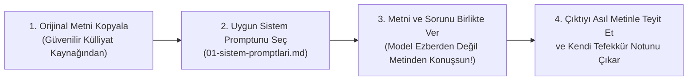

# 🛠️ Nuranî Yapay Zekâ Mütalaa Kiti (`ai-mutalaa-araclari/`)

> *"Yapay zekâ asıl metnin yerine geçen bir hoca değil; elinden tutup seni orijinal Külliyat metninin derinliklerine indiren sadık bir kütüphane hizmetkârıdır."*

**[Modül 09: Yapay Zekâ Çağında Risale-i Nur'un İnkişafı](../09-AI-Caginda-Nurun-Inkisafi/README.md)** bölümünde teorik çerçevesini çizdiğimiz **Dördüncü Merhale** vizyonunu burada **pratik araçlara** dönüştürüyoruz.

Bu klasör iki temel kitle için hazırlandı:
1. **Okuyucular ve Müzakere Halkaları İçin:** Kullandığın herhangi bir yapay zekâ modelini (Gemini, Claude, ChatGPT veya yerel açık kaynak modelleri) halüsinasyon yapmayan, metin asliyetine sadık bir **Medrese-i Nuriye Mütalaa Asistanına** dönüştürecek hazır **Sistem Promptları (`System Prompts`)**.
2. **Yazılımcılar, Mühendisler ve Araştırmacılar İçin:** İman hakikatlerine dijital çağda hizmet etmek isteyen geliştiricilerin hemen forklayıp inşa edebileceği **Açık Kaynak Sadaka-i Cariye Proje Mimarileri (`risale-mcp`, Doğrulanmış RAG Şeması, Bilgi Grafiği)**.

---

## 📂 Bu Kitteki Rehberler

1. **[01: Hazır Sistem Promptları Kütüphanesi (6 Özel Mod)](./01-sistem-promptlari.md)**  
   *Kopyala-yapıştır ile hemen kullanabileceğin; Metin Sadakatli Şerh, Mânâ-yı Harfî Bilim Tercümanı, Deizm/Şüphe Triyaj Rehberi, Mermaid Argüman Haritacısı, Sokratik Nefis Muhasebesi ve Çok Dilli Kültürel Tercüme şablonları.*
2. **[02: Dijital Sadaka-i Cariye Proje Yol Haritası (`Builders Roadmap`)](./02-dijital-proje-fikirleri.md)**  
   *`risale-mcp` (Model Context Protocol Sunucusu), Halüsinasyonsuz Külliyat RAG Veritabanı standardı, Esmâ-i Hüsna `JSON-LD` Bilgi Grafiği ve İnteraktif Temsil Simülasyonları için teknik şartnameler.*

---

## 🛡️ Altın Kullanım Protokolü: "Metin Bağlama (`Context Grounding`)"

Dil modellerinden Risale-i Nur çalışırken **%100 doğruluk** almak için şu 3 adımlı iş akışını uygula:

> [!IMPORTANT]
> Modele asla metin vermeden *"Bana 23. Lem'a'dan bir paragraf yaz"* deme; çünkü dil modelleri ezberden yazarken kelimeleri değiştirebilir! Her zaman **orijinal paragrafı kendin yapıştır** ve modelden **o yapıştırdığın metin üzerinde** analiz yapmasını iste!

---

⬅️ **[Modül 09: AI Çağında Nur'un İnkişafı](../09-AI-Caginda-Nurun-Inkisafi/README.md)** | ➡️ **[01: Hazır Sistem Promptları Kütüphanesi](./01-sistem-promptlari.md)**
