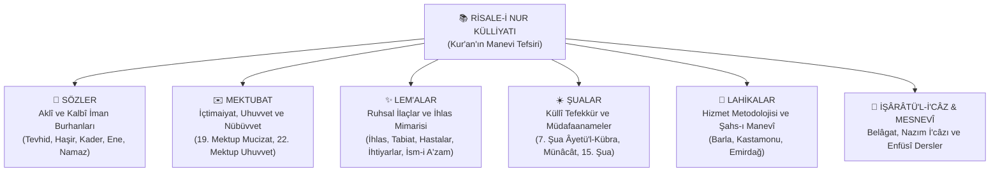
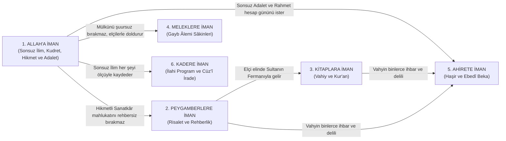
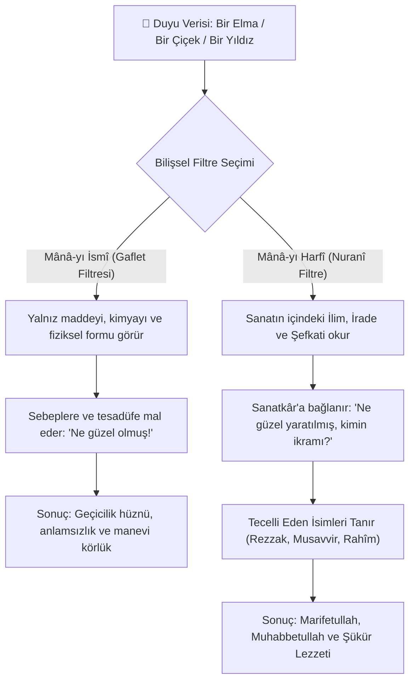
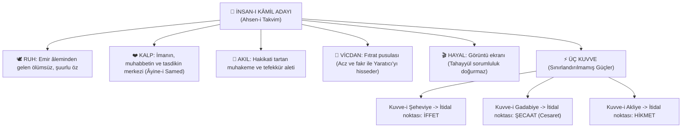
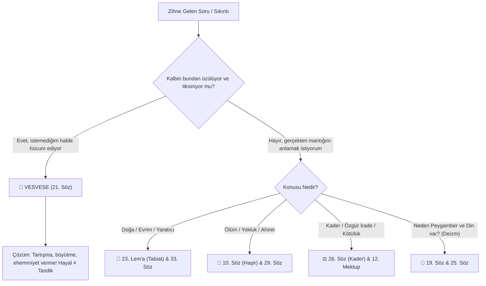
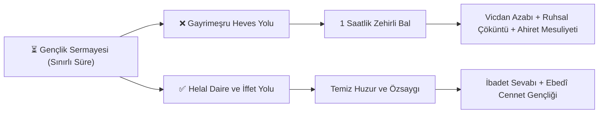
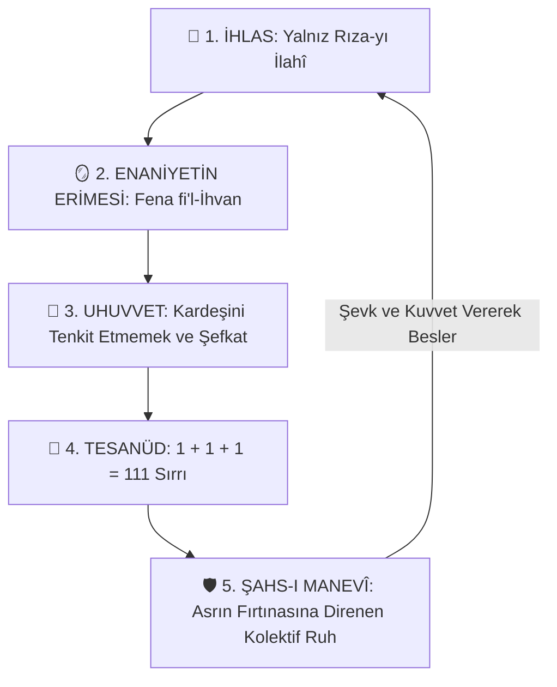

# 🗺️ Görsel Hakikat ve Burhan Atlası (`zihin-haritalari/`)

> *"Temsil, uzak hakikatleri yakınlaştıran bir dürbündür; şema ise dağınık burhanları tek bakışta zihne mühürleyen bir haritadır."*

Bu atlas, Risale-i Nur Külliyatı'ndaki temel iman, ontoloji, psikoloji ve içtimaiyat hakikatlerini **7 bütünsel zihin haritası** halinde görselleştirir. Ders müzakerelerinde, sunumlarda ve kişisel tefekkürde hızlı başvuru haritası olarak kullanabilirsin.

---

## Harita 1: Külliyat-ı Nur Bütünsel Mimari Haritası

Hangi ana eserin insan ruhunun hangi temel ihtiyacına cevap verdiğini gösteren kuşbakışı harita:

---

## Harita 2: İman Erkânlarının Birbirini İspat Zinciri (`Telâzüm-ü Erkân`)

İmanın altı şartı birbirinden kopuk maddeler değildir; bir halka ispatlandığında diğer tüm halkaları mantıksal zorunlulukla netice verir:

---

## Harita 3: Mânâ-yı İsmî vs. Mânâ-yı Harfî Bilişsel İşlem Hattı

Duyularımızla algıladığımız aynı dış dünya verisinin zihinde iki zıt yoruma dönüşme süreci:

---

## Harita 4: İnsanın Manevi Anatomisi (`Lâtifeler ve Kuvveler Haritası`)

Risale-i Nur'da insan sadece "akıl ve beden"den ibaret görülmez; ebediyete uzanan zengin bir lâtifeler topluluğudur:

---

## Harita 5: Şüphe, Vesvese ve İstifham Tanı Ağacı (`Manevi Triyaj`)

Zihne gelen her rahatsız edici düşünce aynı kategoriye girmez; yanlış teşhis yanlış tedavi doğurur:

---

## Harita 6: Gençlikte Zaman ve Lezzet Ekonomisi (13. Söz & Gençlik Rehberi)

---

## Harita 7: İhlas, Uhuvvet ve Şahs-ı Manevî Geri Besleme Döngüsü

---

⬅️ **[AI Mütalaa Araçlarına Dön](../ai-mutalaa-araclari/README.md)** | ➡️ **[Ana Sayfaya Dön](../README.md)**
